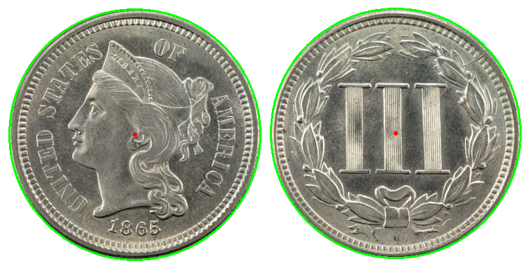

# hough_circle

RT 视觉组培训任务三：带图形界面的霍夫圆检测小工具。

## 功能

- 导入本地图片
- 调整 HoughCircles 参数（dp、minDist、param1、param2、半径范围）
- 实时预览检测结果
- 导出带标注的图片

## 环境

- Ubuntu 24.04（WSL2，WSLg 提供图形界面）
- Python 3.12
- OpenCV 4.6.0
- NumPy 1.26.4
- tkinter 8.6（GUI）

无需额外 pip 安装：上述依赖由系统包提供。

## 启动方式

```bash
python3 src/hough_circle_gui.py
```

### 使用步骤

1. 点击“导入图片”选择本地图片（JPEG、PNG、BMP、TIFF）。
2. 拖动右侧滑杆调整参数；预览与状态栏会自动刷新，无需额外点击检测按钮。
3. 点击“导出标注图”，按原图分辨率保存当前检测结果。

### 参数控件

| 参数 | 范围 | 步长 | 默认值 | 说明 |
|---|---|---|---|---|
| `dp` | 1.0–3.0 | 0.1 | 1.2 | 累加器分辨率倒数 |
| `minDist` | 1–1000 | 1 | 300 | 圆心最小间距（像素） |
| `param1` | 1–500 | 1 | 100 | Canny 高阈值 |
| `param2` | 1–300 | 1 | 100 | 圆心累加器阈值 |
| 最小半径 | 0–1000 | 1 | 0 | 像素 |
| 最大半径 | 0–1000 | 1 | 0 | 像素 |

半径 0 表示不限制；仅当最小、最大半径同时为 0 时视为不限制，否则要求最大半径大于最小半径。

## 样例图片

两张验收图随仓库提供，无需另外下载：

- `examples/coins.jpg`：760×385，两枚硬币
- `examples/cookie-plate.jpg`：520×520，一个盘子

获取方式：克隆仓库后文件已在 `examples/` 目录内（`git clone https://github.com/QuYunqing080529/hough-circle-tool.git`），或在仓库页面用 Download ZIP 解压获取。

## 验收图片与参数

| 图片 | 期望结果 | 验收参数 |
|---|---|---|
| `examples/coins.jpg` | 标出两个硬币外缘 | `dp=1.2, minDist=300, param1=100, param2=100, minRadius=0, maxRadius=0` |
| `examples/cookie-plate.jpg` | 标出一个盘沿 | `dp=1.2, minDist=300, param1=100, param2=100, minRadius=0, maxRadius=0` |

两张图共用该组参数。

实际运行结果：

| 图片 | 检测结果 `(x, y, r)` | 圆数量 | 结果图 |
|---|---|---|---|
| `examples/coins.jpg` | `(567, 191, 179)`、`(193, 193, 180)` | 2 |  |
| `examples/cookie-plate.jpg` | `(263, 259, 244)` | 1 |  |

## 无头复现验收

没有图形环境（或不想开窗口）时，用下面这条命令复现「验收图片与参数」的结果：

```bash
PYTHONPATH=src python3 -c "
from circle_detector import HoughParams, load_image, detect_circles
p = HoughParams()
for f in ('examples/coins.jpg', 'examples/cookie-plate.jpg'):
    print(f, detect_circles(load_image(f), p))
"
```

预期输出：

```text
examples/coins.jpg [(567, 191, 179), (193, 193, 180)]
examples/cookie-plate.jpg [(263, 259, 244)]
```

这条命令只依赖仓库内的样例图片与系统自带的 OpenCV/NumPy，不需要 GUI，也不需要额外安装。

## 目录结构

```
hough_circle/
├── README.md
├── .gitignore
├── src/          # 源码
├── examples/     # 验收图片（coins.jpg、cookie-plate.jpg）
├── docs/         # 标注结果图
└── openspec/     # OpenSpec 规格与变更记录
```

## 开发流程

使用 OpenSpec 管理变更：

1. 在 `openspec/changes/` 下建立变更提案
2. 确认规格与任务清单
3. 实现并记录验收结果
4. 归档变更

## 状态

- [x] 项目初始化与 OpenSpec 配置
- [x] 霍夫圆检测核心逻辑
- [x] 图形界面
- [x] 两张验收图通过
- [x] README 补全验收参数与结果图
- [x] README 补齐样例获取方式与无头复现命令
- [x] 新增 `add-video-detection` 变更提案（视频检测，仅设计未实现）


## 交接状态（2026-11-18）

- 当前版本：单图霍夫圆检测 + tkinter 界面，功能已实现并通过验收（见上文验收表与结果图）。
- 开放变更：`openspec/changes/add-video-detection/` —— 计划增加「导入视频完成检测」，**仅完成设计与任务拆分，尚未实现**。
- 复现基线：按「无头复现验收」执行，应得到与验收表一致的 2 个圆 / 1 个圆。
- 未验证事项：WSLg 下视频播放性能、非默认编码视频的解码、4K 视频逐帧检测耗时、视频模式下暂停与改参的并发行为（详见该变更 `tasks.md`）。
- 接手入口：先读 `openspec/changes/add-video-detection/proposal.md` 与 `design.md`，再从 `tasks.md` 的「后续待办」第 1 条开始；核心逻辑可无头验收，不必先做界面。
- 已知约束：不新增 pip 依赖；`detect_circles` / `validate` / `annotate` 的签名与语义保持不变。
