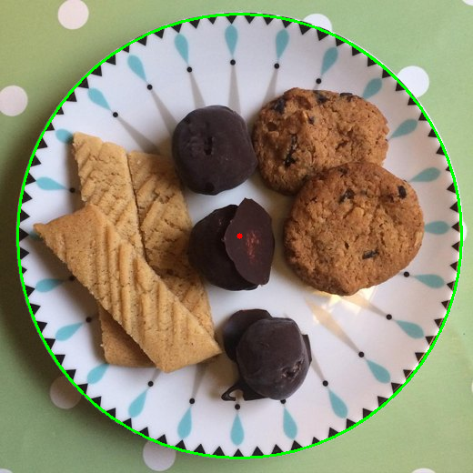

# hough_circle

RT 视觉组培训任务三：带图形界面的霍夫圆检测小工具。

## 功能

- 导入本地图片
- 调整 HoughCircles 参数（dp、minDist、param1、param2、半径范围）
- 实时预览检测结果
- 导出带标注的图片

## 环境

- Ubuntu 24.04（WSL2，WSLg 提供图形界面）
- Python 3.12
- OpenCV 4.6.0
- NumPy 1.26.4
- tkinter 8.6（GUI）

无需额外 pip 安装：上述依赖由系统包提供。

## 启动方式

```bash
python3 src/hough_circle_gui.py
```

### 使用步骤

1. 点击“导入图片”选择本地图片（JPEG、PNG、BMP、TIFF）。
2. 拖动右侧滑杆调整参数；预览与状态栏会自动刷新，无需额外点击检测按钮。
3. 点击“导出标注图”，按原图分辨率保存当前检测结果。

### 参数控件

| 参数 | 范围 | 步长 | 默认值 | 说明 |
|---|---|---|---|---|
| `dp` | 1.0–3.0 | 0.1 | 1.2 | 累加器分辨率倒数 |
| `minDist` | 1–1000 | 1 | 300 | 圆心最小间距（像素） |
| `param1` | 1–500 | 1 | 100 | Canny 高阈值 |
| `param2` | 1–300 | 1 | 100 | 圆心累加器阈值 |
| 最小半径 | 0–1000 | 1 | 0 | 像素 |
| 最大半径 | 0–1000 | 1 | 0 | 像素 |

半径 0 表示不限制；仅当最小、最大半径同时为 0 时视为不限制，否则要求最大半径大于最小半径。

## 验收图片与参数

| 图片 | 期望结果 | 验收参数 |
|---|---|---|
| `examples/coins.jpg` | 标出两个硬币外缘 | `dp=1.2, minDist=300, param1=100, param2=100, minRadius=0, maxRadius=0` |
| `examples/cookie-plate.jpg` | 标出一个盘沿 | `dp=1.2, minDist=300, param1=100, param2=100, minRadius=0, maxRadius=0` |

两张图共用该组参数。

实际运行结果：

| 图片 | 检测结果 `(x, y, r)` | 圆数量 | 结果图 |
|---|---|---|---|
| `examples/coins.jpg` | `(567, 191, 179)`、`(193, 193, 180)` | 2 |  |
| `examples/cookie-plate.jpg` | `(263, 259, 244)` | 1 |  |

## 目录结构

```
hough_circle/
├── README.md
├── .gitignore
├── src/          # 源码
├── examples/     # 验收图片（coins.jpg、cookie-plate.jpg）
├── docs/         # 标注结果图
└── openspec/     # OpenSpec 规格与变更记录
```

## 开发流程

使用 OpenSpec 管理变更：

1. 在 `openspec/changes/` 下建立变更提案
2. 确认规格与任务清单
3. 实现并记录验收结果
4. 归档变更

## 状态

- [x] 项目初始化与 OpenSpec 配置
- [x] 霍夫圆检测核心逻辑
- [x] 图形界面
- [x] 两张验收图通过
- [x] README 补全验收参数与结果图